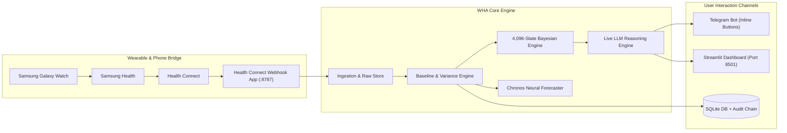

# Wearable Health Agent (WHA)

> **Agentic early-warning, physiological anomaly detection, and exact causal attribution for consumer wearable data.**

Consumer smartwatches detect that something in your body changed--a raised overnight resting heart rate (RHR), reduced HRV, or fragmented sleep. **However, wrist sensors cannot tell you why.** An elevated nocturnal resting heart rate of $+3.5\text{ bpm}$ can be caused by an incubating viral respiratory infection, alcohol consumed with dinner, intense late-evening training, short sleep, acute psychological stress, a recent vaccination, or the menstrual luteal phase. To an optical sensor on the wrist, these look nearly identical, yet they demand opposite responses.

**WHA solves this by decoupling continuous passive monitoring from episodic agentic investigation.** 

```
┌─────────────────────────────────────────────────────────────────────────────────┐
│ DAILY PASSIVE MONITOR (Tier 0)                                                  │
│ Local CPU • Plain Python • Closed-Form Statistics • Zero LLM Calls • $0 Cost    │
│ 00:00–07:00 Sleep Extraction ──> Coverage Gate ──> Shrinkage Baseline ──> Test  │
└──────────────────────────────────────┬──────────────────────────────────────────┘
                                       │
                      ┌────────────────┴────────────────┐
                      ▼ Quiet Night                     ▼ Anomaly Flagged
               Write Log Row ($0)             ┌───────────────────────────────────┐
                                              │ DETERMINISTIC RED-FLAG FLOOR      │
                                              │ Hard-coded emergency triage rules │
                                              └───────────────┬───────────────────┘
                                                              │
                                            ┌─────────────────┴─────────────────┐
                                            ▼ Emergency Crossed                 ▼ Clear
                                      ESCALATE to Care             ┌─────────────────────────┐
                                                                   │ BOUNDED AGENT (Tier 1)  │
                                                                   │ Exact 4,096-State Bayes │
                                                                   │ EVSI Interruption Math  │
                                                                   │ LLM Clinical Dialogue   │
                                                                   └────────────┬────────────┘
                                                                                │
                                                                                ▼
                                                                   ┌─────────────────────────┐
                                                                   │ DELIVERY (Tier 2)       │
                                                                   │ Telegram Inline Buttons │
                                                                   │ Streamlit Web Dashboard │
                                                                   │ SHA-256 Audit Trail     │
                                                                   └─────────────────────────┘
```

---

## Key Clinical & Architectural Invariants

1. **Zero-LLM Passive Monitoring**: Every morning at 09:00 AM, the nightly batch processes the 00:00–07:00 sleep window using robust statistics (MAD scaling, empirical Bayes shrinkage towards population prior $\mu_0=62.0\text{ bpm}, \sigma_0=7.5\text{ bpm}$, and explained-variance subtraction). On normal nights, **execution cost is zero and no language model is invoked**.
2. **Deterministic Emergency Safety Floor**: If critical symptoms are reported (e.g., acute chest pain, severe dyspnea, confusion from `data/knowledge/red_flags.yaml`), the system **immediately executes `ESCALATE` and completely bypasses generative models**.
3. **Exact 12-Cause Bayesian Belief Engine**: Evaluates joint probabilities over all $2^{12} = 4,096$ discrete causal combinations in log-space, using peer-reviewed effect sizes and temporal onset/decay curves.
4. **Arithmetic Value-of-Information Policy**: Decides whether to stay silent (`OBSERVE`), ask a targeted symptom question (`ASK`), order a spot check (`MEASURE`), or draft a differential (`CONCLUDE`) strictly via **Expected Value of Sample Information (EVSI) minus Interruption Cost**. The LLM cannot decide to interrupt or spam the patient on its own.
5. **Fail-Closed Data Quality Gates**: Requires $\ge 240\text{ minutes}$ (4 hours) of nocturnal sensor coverage and refuses biometrics older than 48 hours. The system never fabricates heart rates or invents missing data.
6. **Strict Outbound Safety & Grounding**: Outbound messages pass 6 deterministic checks (length, control characters, URL whitelisting, slot matching, callback sizes). All clinical assertions are strictly grounded against cited medical literature in `data/knowledge/`.
7. **Cryptographic Immutability**: Every tool call, Bayesian update, human interaction, and LLM reasoning step is logged with **SHA-256 cryptographic hash chaining** into SQLite for tamper-evident clinical auditability.

---

## Production Hardware & Subsystem Integrations

WHA connects live wearable sensors, language models, and mobile notifications:



* **⌚ Phone Bridge (Health Connect Webhook)**: Ingests raw heart rate samples, step counts, and sleep stages directly from Android Health Connect over local HTTP (`:8787`) with Bearer token authentication.
* **🤖 Live LLM Inference API**: Compatible with OpenAI, DeepSeek (`deepseek-chat`, `gpt-4o`, `gpt-4.1-mini`), Ollama, OpenRouter, or offline recorded cassettes with automatic Pydantic v2 JSON repair.
* **💬 Telegram Companion Bot**: Pushes instant anomaly alerts and interactive symptom questionnaires with 1-tap clickable inline keyboard buttons directly to your mobile phone.
* **📈 Chronos Foundation Model (`amazon/chronos-bolt-small`)**: Pretrained zero-shot time-series forecaster cached in `data/model_cache/` that supplies an advisory prediction interval, solving the cold-start problem (Days 1–5).

---

## Quickstart

### 1. Prerequisites & Installation

Requires **Python 3.12** and [`uv`](https://github.com/astral-sh/uv):

```bash
# Clone the repository
git clone https://github.com/NatBrian/wearable-health-agent.git
cd wearable-health-agent

# Install dependencies and sync virtual environment
uv sync
```

### 2. Configure Environment (`.env`)

Create or edit `.env` in the repository root:

```dotenv
# --- Storage ---
WHA_DB_PATH=data/wha.sqlite
WHA_SUBJECT=me
WHA_TIMEZONE=Asia/Singapore

# --- Live LLM Inference Provider ---
WHA_LLM_PROVIDER=openai_compatible
WHA_LLM_BASE_URL=https://api.gptplus5.com/v1     # or https://api.openai.com/v1
WHA_LLM_MODEL=deepseek-chat                      # or gpt-4o, gpt-4.1-mini
WHA_LLM_API_KEY=sk-your-api-key-here

# --- Health Connect Phone Bridge ---
WHA_BRIDGE_URL=http://192.168.198.181:8787
WHA_BRIDGE_TOKEN=your-phone-bridge-bearer-token

# --- Telegram Mobile Notifications ---
WHA_NOTIFY_CHANNEL=telegram
WHA_TELEGRAM_BOT_TOKEN=123456789:ABCDefghIJKlmnoPQRstuvw
WHA_TELEGRAM_CHAT_ID=your-telegram-chat-id
```

### 3. Run Unified System Diagnostics (`wha doctor`)

WHA provides two diagnostic modes:

```bash
# Fast offline configuration & file audit
uv run wha doctor

# Real-time active hardware, LLM, and Telegram network probe
uv run wha doctor --live
```

**Live Verification Output:**
```text
================================================================================
CLINICAL PRODUCTION SYSTEM DIAGNOSTIC & HEALTH SUITE
================================================================================

[MANDATORY PRODUCTION SUBSYSTEMS]
  [PASS]    Database & Cryptographic Audit Log   -> Schema v1 verified
  [PASS]    Clinical Knowledge Tables            -> Loaded 12 cited causes, 9 clinical probes
  [PASS]    Phone Hardware Bridge                -> Connected to bridge at http://192.168.198.181:8787 (255ms)
  [PASS]    Live LLM Inference API               -> LLM provider 'openai_compatible' responded (3858ms)
  [PASS]    Telegram Mobile Bot                  -> Telegram bot connected successfully (2499ms)
  [PASS]    Statistical & Bayesian Engine        -> Deterministic shrinkage, 4096-state posterior ready
  [PASS]    Chronos Neural Forecaster            -> Amazon Chronos-Bolt model weights cached

[OPTIONAL / ADVISORY SUBSYSTEMS]
  [INFO]    Research Benchmark Cohorts           -> Stanford & PMData benchmark targets present

================================================================================
RESULT: ALL MANDATORY SUBSYSTEMS OPERATIONAL. PRODUCTION READY.
================================================================================
```

### 4. Launch Web Dashboard & Background Scheduler

```bash
uv run wha serve --port 8501
```

Access the dashboard at `http://localhost:8501`. The server runs the 24/7 background scheduler:
* **Every 30 mins**: Ingests new wearable samples from the phone bridge.
* **Daily at 09:00 AM**: Derives overnight baseline features, executes anomaly detection, and triggers causal episodes if flagged.
* **Every 15 mins**: Ticks interaction timeouts and advances open episodes.

---

## Three Symmetrical Configuration Interfaces

You can configure, test, and manage the system through whichever interface you prefer:

| Interface | How to Use | What It Supports |
|---|---|---|
| **Web Dashboard** | Open `http://localhost:8501/Settings` | Live test buttons for Bridge, LLM, and Telegram; secret inputs; one-click persistent saves; permanent data purge. |
| **Environment File** | Edit `.env` | File-based persistent configuration for headless and production deployments. |
| **CLI Overrides** | `uv run wha ... --live` | Inline shell flags, temporary runtime overrides, and diagnostic probing. |

---

## Command-Line Interface (CLI) Reference

```bash
# Diagnostics & Health
uv run wha doctor                # Fast offline configuration check
uv run wha doctor --live         # Live network, hardware, and LLM probe check

# Data & Ingestion
uv run wha ingest --days 3       # Fetch & normalize live biometrics from phone bridge
uv run wha nightly               # Run daily baseline calculation & anomaly detector
uv run wha data fetch chronos    # Download Amazon Chronos-Bolt neural forecaster
uv run wha data fetch stanford   # Initialize Stanford benchmark evaluation cohort
uv run wha data fetch pmdata     # Initialize PMData benchmark evaluation cohort

# Demonstrations & Scenarios
uv run wha demo list             # List available offline clinical replay scenarios
uv run wha demo run illness-onset --live  # Run illness scenario against live LLM

# Investigation & Bayesian Belief
uv run wha episode list          # View active and resolved clinical episodes
uv run wha episode step <id>     # Manually advance an episode cycle
uv run wha belief explain        # Output exact mathematical marginals over 12 causes

# Academic Benchmark Evaluations
uv run wha eval detection        # Evaluate sensitivity vs. heuristic baselines
uv run wha eval policy           # Evaluate EVSI value-of-information vs. never-ask
```

---

## Web Dashboard Overview (`wha serve`)

* **📅 Today (`/Today`)**: Real-time status banner (bridge freshness, baseline maturity rung, 24h errors), active clinical episodes, and pending symptom questionnaires.
* **📊 History (`/History`)**: Multi-month interactive nocturnal RHR charts, shrinkage baseline bands, and color-coded episode spans (`GREEN`, `YELLOW`, `RED`).
* **🛡️ Audit (`/Audit`)**: Full cryptographic SHA-256 tamper-evident log viewer with hash-chain integrity verification and JSON/CSV export.
* **🧪 Evaluation (`/Evaluation`)**: Benchmark evaluation metrics comparing WHA against heuristic, static-threshold, and unguided baselines.
* **⚙️ Settings (`/Settings`)**: Live connectivity test buttons for Phone Bridge, LLM Provider, and Telegram; weekly interruption budget adjusters; data destruction controls.

---

## Identifiability Boundaries & Clinical Reality

* **Autonomic Response vs. Etiology**: Wearable optical sensors observe host autonomic nervous system changes (tachycardia, reduced vagal tone), not circulating pathogens. WHA cannot differentiate Influenza A from COVID-19 without self-reported symptoms or rapid antigen test results.
* **Confounder Magnitudes**: Acute viral infections elevate nocturnal RHR by $+1.1\text{ to }+2.1\text{ bpm}$, whereas alcohol or late-night exercise can elevate RHR by $+2.4\text{ to }+6.0\text{ bpm}$. The system relies on its value-of-information policy to ask discriminating questions when biometrics alone are ambiguous.
* **Maturity Ladder**:
  * `0-2 Nights` (`COLD`): Population prior only ($\mu=62.0, \sigma=7.5$).
  * `3-6 Nights` (`PRIOR_DOMINATED`): Shrinkage heavily weighted to population prior.
  * `7-13 Nights` (`SHRINKING`): Empirical Bayes shrinkage transitioning to personal data.
  * `14-27 Nights` (`PERSONAL`): Personal median & MAD dominate.
  * `28+ Nights` (`MATURE`): Fully personalized trailing baseline with Chronos advisory bands.

---

## Corpus & Knowledge Sources

* **`data/knowledge/causes.yaml`**: 12 cited clinical causes with peer-reviewed effect sizes, population base rates, and temporal dynamics.
* **`data/knowledge/probes.yaml`**: 9 structured clinical questions with cited likelihood rows over discrete answer slots.
* **`data/knowledge/red_flags.yaml`**: Emergency clinical symptoms requiring immediate escalation.
* **`data/knowledge/sources.yaml`**: Complete bibliographic citations for all clinical numbers.

---

## Disclaimer

This software is a research prototype and personal health intelligence system. It is **not an FDA/CE-certified medical device**, does not provide formal medical diagnoses, and must not be used as a substitute for professional medical care or emergency services. If you experience severe chest pain, shortness of breath, or emergency symptoms, seek immediate professional medical attention.
