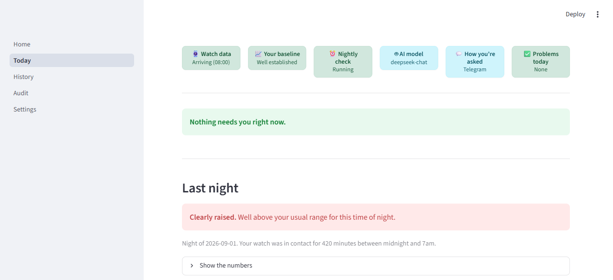
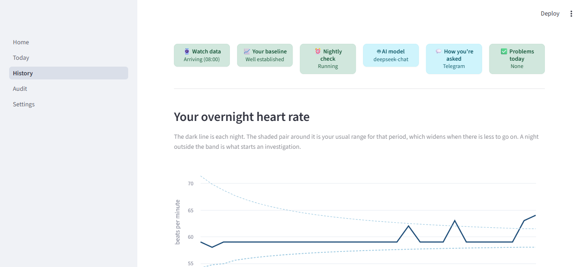
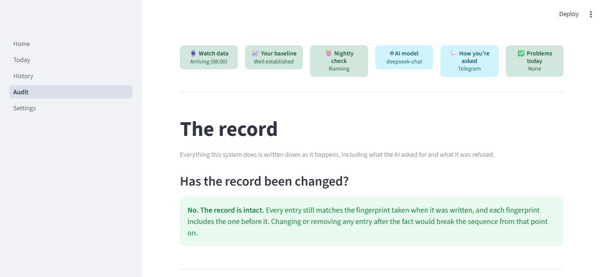

# Wearable Health Agent (WHA)

> **Agentic early-warning, physiological anomaly detection, and exact causal attribution for consumer wearable data.**

Consumer smartwatches detect that something in your body changed--a raised overnight resting heart rate (RHR), reduced HRV, or fragmented sleep. **However, wrist sensors cannot tell you why.** An elevated nocturnal resting heart rate of $+3.5\text{ bpm}$ can be caused by an incubating viral respiratory infection, alcohol consumed with dinner, intense late-evening training, short sleep, acute psychological stress, a recent vaccination, or the menstrual luteal phase. To an optical sensor on the wrist, these look nearly identical, yet they demand opposite responses.

**WHA solves this by decoupling continuous passive monitoring from episodic agentic investigation.** 

```
┌─────────────────────────────────────────────────────────────────────────────────┐
│ DAILY PASSIVE MONITOR (Tier 0)                                                  │
│ Local CPU • Plain Python • Closed-Form Statistics • Zero LLM Calls • $0 Cost    │
│ Recorded-Sleep Extraction ──> Coverage Gate ──> Shrinkage Baseline ──> Test    │
└──────────────────────────────────────┬──────────────────────────────────────────┘
                                       │
                      ┌────────────────┴────────────────┐
                      ▼ Quiet Night                     ▼ Anomaly Flagged
               Write Log Row ($0)             ┌───────────────────────────────────┐
                                              │ DETERMINISTIC RED-FLAG FLOOR      │
                                              │ Hard-coded emergency triage rules │
                                              └───────────────┬───────────────────┘
                                                              │
                                            ┌─────────────────┴─────────────────┐
                                            ▼ Emergency Crossed                 ▼ Clear
                                      ESCALATE to Care             ┌─────────────────────────┐
                                                                   │ BOUNDED AGENT (Tier 1)  │
                                                                   │ Exact 4,096-State Bayes │
                                                                   │ EVSI Interruption Math  │
                                                                   │ LLM Clinical Dialogue   │
                                                                   └────────────┬────────────┘
                                                                                │
                                                                                ▼
                                                                   ┌─────────────────────────┐
                                                                   │ DELIVERY (Tier 2)       │
                                                                   │ Telegram Inline Buttons │
                                                                   │ Streamlit Web Dashboard │
                                                                   │ SHA-256 Audit Trail     │
                                                                   └─────────────────────────┘
```

---

> **Project status:** see **[STATUS.md](STATUS.md)** for what works, what does not, and
> what still needs a human decision.

## What data it uses, and why not more

Health Connect defines around sixty kinds of health data. This system uses the seven a
Galaxy Watch 5 actually provides, and four of those can change a conclusion. Nothing is
filtered out, and the full raw payload is retained regardless.

Supporting the rest is not planned. Most of it has no bearing on illness, and the three
channels that would help (heart rate variability, respiratory rate, skin temperature) are
not recorded by this device, cannot be computed from one-minute heart rate averages, and
would not solve the problem the system exists for: they move in the same direction for
infection, stress, poor sleep and the luteal phase alike.

The reasoning, the measurements behind it and the sources are in
**[docs/DESIGN-DATA-CHANNELS.md](docs/DESIGN-DATA-CHANNELS.md)**. Run
`uv run wha data capability` to see what your own device provides.

---

## Key Clinical & Architectural Invariants

1. **Zero-LLM Passive Monitoring**: Nights are scored on a repeating interval rather than at a fixed hour, over **the sleep the watch actually recorded**, falling back to 00:00-07:00 only when it recorded none. A cron at 09:00 assumed the person was awake and synced by then; the first real subject wakes around 11:00, so their night was scored before it had finished being recorded. Robust statistics throughout: MAD scaling, empirical Bayes shrinkage toward a population centre of 62.75 bpm with a **within-person** night-to-night scale of 3.71 bpm measured on 107 people, and explained-variance subtraction. The between-person SD of 8.64 is deliberately NOT used for the band; see `docs/DESIGN-BASELINE-CENTRE.md`. On normal nights, **execution cost is zero and no language model is invoked**.
2. **Deterministic Emergency Safety Floor**: Phrase matching against `data/knowledge/red_flags.yaml` runs on the person's own words **before any model sees them**, and an LLM may only ever ADD a flag, never remove one. Two honest qualifications, because an earlier version of this line overstated both halves. **It does not always escalate immediately:** chest pain maps to a validated decision rule (Marburg Heart Score), so it opens that rule's questions instead of escalating on a phrase, which is the argument of Downie et al. 2013 about single red flags. Presentations with no validated history-only rule, and the unconditional gates such as collapse or crushing pain, do escalate on the spot. **And it does not bypass generative models:** tier C is an additive LLM check that runs on every free-text message. What no model can do is lower the urgency the fixed rules set.
3. **Exact 12-Cause Bayesian Belief Engine**: Evaluates joint probabilities over all $2^{12} = 4,096$ discrete causal combinations in log-space, using peer-reviewed effect sizes and temporal onset/decay curves.
4. **Arithmetic Value-of-Information Policy**: Decides whether to stay silent (`OBSERVE`), ask a targeted symptom question (`ASK`), or draft a differential (`CONCLUDE`) strictly via **Expected Value of Sample Information (EVSI) minus Interruption Cost**. The LLM cannot decide to interrupt or spam the patient on its own. The spot-check limb (`MEASURE`) was deleted on 5 September 2026: it rested on three numbers with no source and asked the noisier instrument to adjudicate the less noisy one.
5. **Fail-Closed Data Quality Gates**: Requires $\ge 180\text{ minutes}$ (3 hours) of nocturnal sensor coverage and refuses biometrics older than 72 hours. The system never fabricates heart rates or invents missing data.
6. **Strict Outbound Safety & Grounding**: Outbound messages pass 6 deterministic checks (length, control characters, URL whitelisting, slot matching, callback sizes). All clinical assertions are strictly grounded against cited medical literature in `data/knowledge/`.
7. **Cryptographic Immutability**: Every tool call, Bayesian update, human interaction, and LLM reasoning step is logged with **SHA-256 cryptographic hash chaining** into SQLite for tamper-evident clinical auditability.

---

## Failure-Mode Philosophy & Fault Tolerance

In medical software engineering (IEC 62304 / ISO 14971), **an auxiliary model outage must never block a safety-critical health alert.** The system enforces strict graceful degradation:

```
┌────────────────────────────────────────────────────────────────────────┐
│ SUBSYSTEM FAILURE SCENARIOS & RECOVERY PATHS                           │
├──────────────────────────┬──────────────────────┬──────────────────────┤
│ Component Failure        │ System Behavior      │ User & UI Visibility │
├──────────────────────────┼──────────────────────┼──────────────────────┤
│ Retrieval index         │ Grounding strips the │ Reply shows the      │
│ (embedding model absent) │ ungrounded sentence; │ amber uncited block; │
│                          │ BM25 alone continues.│ Evidence tab is thin.│
├──────────────────────────┼──────────────────────┼──────────────────────┤
│ Live LLM API             │ Safety filter trips; │ Conversation badge   │
│ (Malformed/Bad Syntax)   │ substitutes clinical │ shows 'Source:       │
│                          │ fallback template.   │ FALLBACK'.           │
├──────────────────────────┼──────────────────────┼──────────────────────┤
│ Total LLM API Outage     │ Checkpoints state;   │ Status strip turns   │
│ (503 / Network Cut)      │ parks episode in DB; │ red; trace tab logs  │
│                          │ never guesses claims │ 'status = parked'.   │
├──────────────────────────┼──────────────────────┼──────────────────────┤
│ Phone Bridge             │ Rejects stale data;  │ Status strip warns   │
│ (Phone Unreachable)      │ refuses to synthesize│ 'Watch: Connection   │
│                          │ fake heart rates.    │ Error (:8787)'.      │
└──────────────────────────┴──────────────────────┴──────────────────────┘
```

* **Why we do NOT halt the pipeline indefinitely**: If a patient develops an acute infection, an auxiliary LLM or PyTorch failure must never prevent their resting heart rate anomaly from being flagged. The deterministic statistical detector and clinical fallback questions deliver immediate alerts regardless of cloud uptime.
* **Full Transparency**: Every fallback, skipped stage, stripped claim, and tool call is recorded in the **Episode Trace Tab** and cryptographic **Audit Journal (`/Audit`)**.

---

## Production Hardware & Subsystem Integrations

WHA connects live wearable sensors, language models, and mobile notifications:


* **⌚ Phone Bridge (Health Connect Webhook)**: Ingests raw heart rate samples, step counts, and sleep stages directly from Android Health Connect over local HTTP (`:8787`) with Bearer token authentication.
* **🤖 Live LLM Inference API**: Compatible with OpenAI, DeepSeek (`deepseek-chat`, `gpt-4o`, `gpt-4.1-mini`), Ollama, OpenRouter, or offline recorded cassettes with automatic Pydantic v2 JSON repair.
* **💬 Telegram Companion Bot**: Pushes instant anomaly alerts and interactive symptom questionnaires with 1-tap clickable inline keyboard buttons directly to your mobile phone.
* **📐 Hybrid Retrieval (BM25 + `BAAI/bge-small-en-v1.5` + Reciprocal Rank Fusion)**: Every clinical sentence the agent produces must **quote a span that is verbatim in a retrieved passage**, or it is stripped or labelled on screen. That check is decidable by code and deliberately narrow: it proves the quoted span exists, not that the sentence around it says what the source says. A neural forecaster was tried here and **removed on measurement**: over 7,295 cohort nights it separated illness worse than the plain baseline residual, AUC 0.586 against 0.629. See `tools/cohort/chronos.py`.

---

## Quickstart

### 1. Prerequisites & Installation

Requires **Python 3.12** and [`uv`](https://github.com/astral-sh/uv):

```bash
# Clone the repository
git clone https://github.com/NatBrian/wearable-health-agent.git
cd wearable-health-agent

# Install dependencies and sync virtual environment
uv sync
```

### 2. Configure Environment (`.env`)

Create or edit `.env` in the repository root:

```dotenv
# --- Storage ---
WHA_DB_PATH=data/wha.sqlite
WHA_SUBJECT=me
WHA_TIMEZONE=Asia/Singapore

# --- Live LLM Inference Provider ---
WHA_LLM_PROVIDER=openai_compatible
WHA_LLM_BASE_URL=https://api.gptplus5.com/v1     # or https://api.openai.com/v1
WHA_LLM_MODEL=deepseek-chat                      # or gpt-4o, gpt-4.1-mini
WHA_LLM_API_KEY=sk-your-api-key-here

# --- Health Connect Phone Bridge ---
WHA_BRIDGE_URL=http://192.168.198.181:8787
WHA_BRIDGE_TOKEN=your-phone-bridge-bearer-token

# --- Telegram Mobile Notifications ---
WHA_NOTIFY_CHANNEL=telegram
WHA_TELEGRAM_BOT_TOKEN=123456789:ABCDefghIJKlmnoPQRstuvw
WHA_TELEGRAM_CHAT_ID=your-telegram-chat-id
```

### 3. Run Unified System Diagnostics (`wha doctor`)

WHA provides two diagnostic modes:

```bash
# Fast offline configuration & file audit
uv run wha doctor

# Real-time active hardware, LLM, and Telegram network probe
uv run wha doctor --live
```

**Live Verification Output:**
```text
database        ok     data\wha.sqlite, schema v8, 72 nights, 2 subjects
knowledge       ok     causes.yaml 12 rows, probes.yaml 8 rows
bridge          ok     configured at http://127.0.0.1:8788 (auth token configured: True)
llm             ok     provider=openai_compatible, model=deepseek-chat (key configured: True)
telegram        ok     chat id and token configured
cohort          ok     Mishra 2020 wearables and labels present in data/cohort
baseline        info   subject 'sim': 41 usable nights, rung MATURE
```

Any row can read `fail`, and `wha doctor` exits non-zero if one does. `--live` additionally
opens the bridge, the model provider and the Telegram bot, and reports the round trip in ms.

### 4. Launch Web Dashboard & Background Scheduler

```bash
uv run wha serve --port 8501
```

Access the dashboard at `http://localhost:8501`. The server runs the 24/7 background scheduler:
* **Every 30 mins**: Ingests new wearable samples from the phone bridge.
* **On a repeating interval, not a fixed hour**: Derives overnight baseline features, executes anomaly detection, and opens an episode if a night is flagged. A night settles as soon as its sleep syncs, whatever time that is.
* **Every 15 mins**: Ticks interaction timeouts and advances open episodes.

---

## Three Symmetrical Configuration Interfaces

You can configure, test, and manage the system through whichever interface you prefer:

| Interface | How to Use | What It Supports |
|---|---|---|
| **Web Dashboard** | Open `http://localhost:8501/Settings` | Live test buttons for Bridge, LLM, and Telegram; secret inputs; one-click persistent saves; permanent data purge. |
| **Environment File** | Edit `.env` | File-based persistent configuration for headless and production deployments. |
| **CLI Overrides** | `uv run wha ... --live` | Inline shell flags, temporary runtime overrides, and diagnostic probing. |

---

## Command-Line Interface (CLI) Reference

```bash
# Diagnostics & Health
uv run wha doctor                # Fast offline configuration check
uv run wha doctor --live         # Live network, hardware, and LLM probe check

# Data & Ingestion
uv run wha ingest --days 3       # Fetch & normalize live biometrics from phone bridge
uv run wha nightly               # Run daily baseline calculation & anomaly detector
uv run wha data fetch corpus     # Build the retrieval corpus, including MedlinePlus
uv run wha data capability       # What your watch sends, and how far each channel gets
uv run python tools/cohort/fetch.py   # The Mishra 2020 cohort, a 378 MB public download
uv run python tools/cohort/labels.py  # Its symptom-onset labels, from the same paper

# Demonstrations & Scenarios
uv run wha demo list             # List available offline clinical replay scenarios
uv run wha demo run illness-onset --live  # Run illness scenario against live LLM

# Investigation & Bayesian Belief
uv run wha episode list          # View active and resolved clinical episodes
uv run wha episode step <id>     # Manually advance an episode cycle
uv run wha belief explain        # Output exact mathematical marginals over 12 causes

# Evaluation
uv run wha eval-report           # Run the offline suites and write EVALUATION.md
uv run wha eval policy           # Real policies through the real belief model
uv run wha eval adversarial      # Prompt-injection containment over 15 cases
uv run wha eval baseline-age     # How the baseline behaves as nights accumulate

# Two suites REFUSE rather than report, and say why when you run them:
#   eval detection  scores detections a caller replays, and nothing in the app replays
#                   them, so it used to print zeros as a benchmark. Detection accuracy
#                   comes from tools/cohort/ and is published in docs/detection-results.json
#   eval ablation   was entirely synthetic: 32 invented participants, scores from
#                   random.Random(42) and a hardcoded table of "effect sizes"

# Conversation, corpus, and the model provider
uv run wha tell "I have a sore throat"   # Say how you feel without waiting to be asked
uv run wha corpus search fever           # What the agent would retrieve for a query
uv run wha corpus build                  # Rebuild the retrievable corpus from the tables
uv run wha llm record illness-onset      # Re-record the offline cassettes for a scenario
```

---

## Web Dashboard Overview (`wha serve`)



*Today: how last night looked, and anything that needs you. The numbers sit behind
"show the numbers" rather than leading.*



*History: your nights against your own usual range. The axis is deliberately not
anchored at zero.*



*The record: every action taken, whether it can still be shown to be unaltered, and an
explanation of the pipeline whose figures are read from the code rather than written by
hand.*


* **📅 Today (`/Today`)**: Real-time status banner (bridge freshness, baseline maturity rung, 24h errors), active clinical episodes, and pending symptom questionnaires.
* **📊 History (`/History`)**: Multi-month interactive nocturnal RHR charts, shrinkage baseline bands, and color-coded episode spans (`GREEN`, `YELLOW`, `RED`).
* **🛡️ Audit (`/Audit`)**: Full cryptographic SHA-256 tamper-evident log viewer with hash-chain integrity verification and JSON/CSV export.
* **⚙️ Settings (`/Settings`)**: Live connectivity test buttons for Phone Bridge, LLM Provider, and Telegram; weekly interruption budget adjusters; data destruction controls.

Benchmark results are not a dashboard page. They live in [EVALUATION.md](EVALUATION.md),
regenerated by `uv run wha eval-report`, because they are evidence for someone assessing
the system rather than something a person checking their own health acts on.

---

## Identifiability Boundaries & Clinical Reality

* **Autonomic Response vs. Etiology**: Wearable optical sensors observe host autonomic nervous system changes (tachycardia, reduced vagal tone), not circulating pathogens. WHA cannot differentiate Influenza A from COVID-19 without self-reported symptoms or rapid antigen test results.
* **Confounder Magnitudes**: Acute viral infections elevate nocturnal RHR by $+1.1\text{ to }+2.1\text{ bpm}$, whereas alcohol or late-night exercise can elevate RHR by $+2.4\text{ to }+6.0\text{ bpm}$. The system relies on its value-of-information policy to ask discriminating questions when biometrics alone are ambiguous.
* **Maturity Ladder**:
  * `0-2 Nights` (`COLD`): Population prior only ($\mu=62.75$ bpm, and a **within-person**
    night-to-night scale of $3.71$ bpm, measured on 107 people in the cohort. The
    between-person SD of $8.64$ is deliberately NOT used here: see `docs/DESIGN-BASELINE-CENTRE.md`).
  * `3-6 Nights` (`PRIOR_DOMINATED`): Shrinkage heavily weighted to population prior.
  * `7-13 Nights` (`SHRINKING`): Empirical Bayes shrinkage transitioning to personal data.
  * `14-27 Nights` (`PERSONAL`): Personal median & MAD dominate.
  * `28+ Nights` (`MATURE`): Trailing 28 night window, the person's own median as the centre.

---

## Corpus & Knowledge Sources

In this repository. Every number carries its own `provenance`, one of three labels:
`CITED` (the number is in the paper), `DERIVED` (worked out from published numbers, with
the working shown) or `ASSUMED` (no published value exists, and the assumption is stated).

**There are no `CITED` rows left in `causes.yaml`, and that is a labelling correction
rather than a loss of evidence.** An audit on 5 September 2026 checked all three against
their sources and none survived: alcohol's own citation text said "it is not what the paper
measured", luteal's effect size is Goodale's but its spread and base rate are not, and
Radin supports recovery_tail's 79 day window and none of its three numbers. A row carries
one label for four numbers, so the label has to describe the weakest of them.

* **`data/knowledge/causes.yaml`**: 12 clinical causes with effect sizes, base rates and
  temporal dynamics. Each row's `derivation` names which of its figures comes from the
  paper, which is worked out from it, and which is `NO EVIDENCE FOUND`.
* **`data/knowledge/probes.yaml`**: 8 structured clinical questions over discrete answer slots. **Every likelihood row is `ASSUMED`.** No published study measures how accurately a person reports drinking, stress or early symptoms to an app the next morning, so the numbers are set flat, which understates how informative a question is and makes the system interrupt less rather than more.
* **`data/knowledge/red_flags.yaml`**: The deterministic safety floor: the urgent list, the same-day list, the two extreme heart-rate bounds and the care-pathway sentences every outcome carries. **Eight of its ten numbers are `ASSUMED` and say so on the Audit page**, because no study was found measuring how many nights a symptom should persist before it is worth an appointment. Loading fails if any of them loses its label.
* **`data/knowledge/sources.yaml`**: The allow-list of external sources, and complete bibliographic citations for all clinical numbers.

Fetched from outside, and not redistributed here:

* **MedlinePlus health topics** (National Library of Medicine, attribution-only). About 1,000 English topics, fetched with `uv run wha data fetch corpus`. This is the only material the agent can cite that describes a condition in general rather than describing this person. Which release is in use, with its SHA-256, is recorded in **`data/knowledge/corpus-sources.json`**. Fetched text is untrusted and is scanned for prompt injection before the model sees it, exactly like any other retrieved passage.

Two layers `sources.yaml` names are still narrower than the design says: StatPearls has never been fetched, and the Singapore care-pathway material exists only as the wording already in `red_flags.yaml`. See `STATUS.md`.

The agent may cite these and nothing else. There is no open web search, and it cannot write clinical text of its own: an assertion whose quoted span is not verbatim in a cited passage is either stripped or labelled on screen as coming from the model's own knowledge. That check proves the span exists; it does not prove the sentence around it describes the source correctly, and `docs/ARCHITECTURE.md` Part 14 shows a real case where it did not. Every figure in the authored corpus was checked against the paper it cites; what held up and what did not is in **`docs/CORPUS-VERIFICATION.md`**, and every clinical figure that was changed, with the source sentence quoted for it, is in **`docs/KNOWLEDGE-CHANGELOG.md`**.

---

## Disclaimer

This software is a research prototype and personal health intelligence system. It is **not an FDA/CE-certified medical device**, does not provide formal medical diagnoses, and must not be used as a substitute for professional medical care or emergency services. If you experience severe chest pain, shortness of breath, or emergency symptoms, seek immediate professional medical attention.
