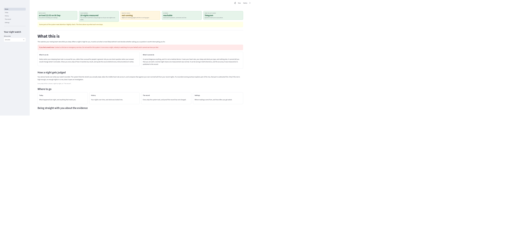
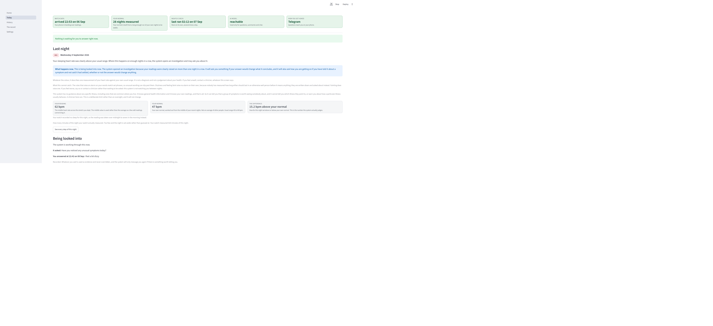
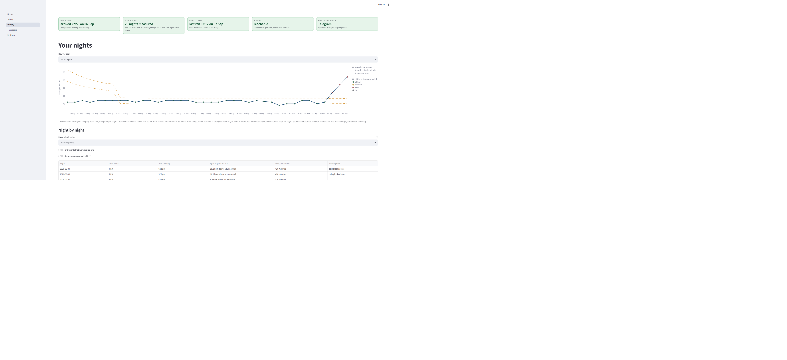
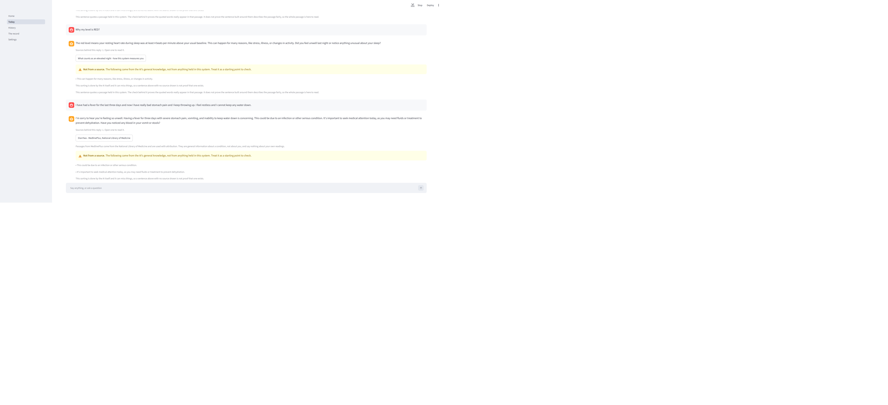
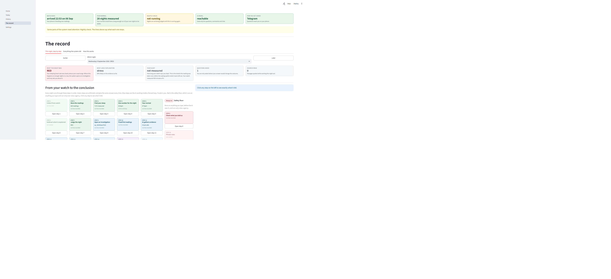
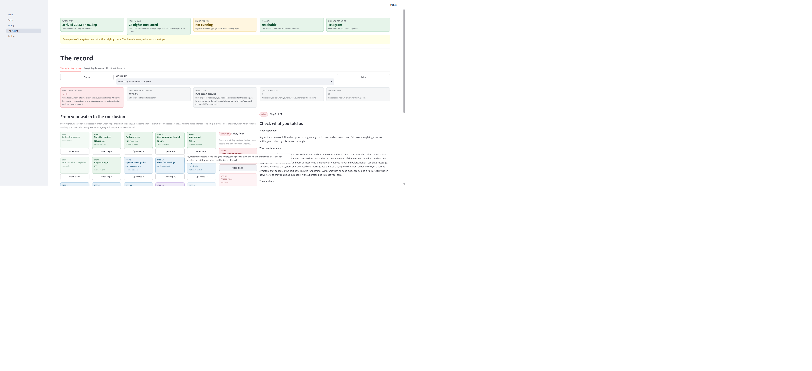
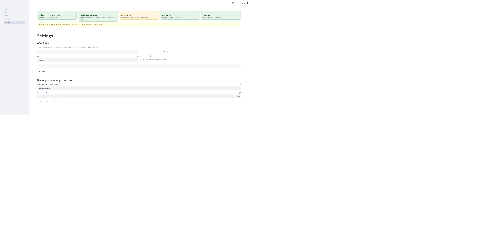

# Using the Wearable Health Agent: a guide

This guide is for the person whose health this is. It assumes no medical knowledge and no
technical background. If you can read your own step count, you can read everything here.

**Before anything else:** this is not a medical device and it cannot diagnose you. If you
feel seriously unwell, contact a doctor. Nothing on any screen changes that.

---

## Contents

1. [What this system actually does](#1-what-this-system-actually-does)
2. [The five screens](#2-the-five-screens)
3. [Home: is everything working?](#3-home-is-everything-working)
4. [Today: how last night went](#4-today-how-last-night-went)
5. [What the colours mean](#5-what-the-colours-mean)
6. [History: your nights over time](#6-history-your-nights-over-time)
7. [When does the AI actually do anything?](#7-when-does-the-ai-actually-do-anything)
8. [Telegram: messages on your phone](#8-telegram-messages-on-your-phone)
9. [Talking to it, and how to trust the answers](#9-talking-to-it-and-how-to-trust-the-answers)
10. [The record: seeing exactly how it decided](#10-the-record-seeing-exactly-how-it-decided)
11. [Settings, and deleting your data](#11-settings-and-deleting-your-data)
12. [What it will never do](#12-what-it-will-never-do)
13. [If something looks wrong](#13-if-something-looks-wrong)

---

## 1. What this system actually does

You wear a watch to bed. Overnight, while you sleep, your heart beats at its slowest and
steadiest rate of the day. That number is a surprisingly good early signal: it tends to rise
a day or two **before** you feel ill.

The problem is that it also rises for boring reasons. Wine with dinner. A hard workout at
9pm. A short night. A stressful day. A vaccination. Where you are in your menstrual cycle.
**On a wrist sensor, all of these look the same as an infection starting.**

So this system does two separate things:

**Every night, quietly, with no AI at all.** It measures your sleeping heart rate, compares
it against what is normal *for you*, and writes down a colour. This costs nothing, runs on
your own machine, and works even if the internet is down.

**Only when something looks off, an AI investigation opens.** It gathers evidence, weighs up
twelve possible causes, and works out whether asking you a question would actually tell it
anything. **If a question would not change its conclusion, it stays quiet.** That is
deliberate. A health app that pings you every morning is one you stop reading.

---

## 2. The five screens

Down the left side of the dashboard:

| Screen | Use it when |
|---|---|
| **Home** | You want to check everything is connected and working. |
| **Today** | Your daily check. How last night went, and anything waiting for you. |
| **History** | You want to see the pattern over weeks, not one night. |
| **The record** | You want to know exactly *how* it reached a conclusion. |
| **Settings** | You are setting up, testing a connection, or deleting your data. |

Most days you only need **Today**.

---

## 3. Home: is everything working?

Home tells you the system is alive and honest about it. It also shows the disclaimer, which
you should read once.

**The most important thing on this page** is that if something is broken, it says so.
A screen showing no data because your phone is unreachable looks exactly like a screen
showing no data because you are perfectly healthy. In a health system those two must never
look the same, so a broken connection is stated in words, not left as an empty chart.

---

## 4. Today: how last night went

This is the screen you will actually use.

Reading it from the top:

### The green strip along the top

Five boxes, each saying whether one part of the system is doing its job:

- **Watch data.** When your phone last handed over readings. In the example, *arrived 22:53
  on 06 Sep*.
- **Your normal.** How many of your own nights it has learned from. *28 nights measured*
  means it knows you well. Fewer than seven, and it cannot judge a night at all yet.
- **Nightly check.** When the overnight calculation last ran.
- **AI model.** Whether the AI is reachable. If not, the colours still work; only the
  conversation stops.
- **How you get asked.** Telegram, or the dashboard.

### "Nothing is waiting for you to answer right now"

If there *is* a question waiting, it appears here, at the very top, before anything else.

### Last night

A colour, a date, and a plain sentence. In the example: **RED**, Wednesday 9 September 2026,
*"Your sleeping heart rate was clearly above your usual range."*

Under it sits a blue box headed **What happens now**. That is the part telling you whether
anything is expected of you.

### The three numbers

| The example says | It means |
|---|---|
| **62 bpm** (your reading) | The middle heart rate across the stretch you slept. The middle value, not the average, so a few odd readings cannot drag it. |
| **47 bpm** (your normal) | *Your* usual, worked out from your own recent nights. Not an average of other people. |
| **15.2 bpm above your normal** | The gap between the two. **This is the number the system actually judges.** |

That last row is the one to look at. 62 bpm on its own means nothing without knowing that
your normal is 47.

### Being looked into

If an investigation is open, it shows what the system asked you and what you replied. In the
example: *"Have you noticed any unusual symptoms today?"* and your answer, *"I feel a bit
dizzy"*.

Anything you say is kept. It is never overwritten, and the system will only message you
again if there is something worth telling you.

---

## 5. What the colours mean

The colour describes **one night's sleeping heart rate against your own usual range**. That
is all it describes. It is not a diagnosis.

| Colour | What it means | What you should do |
|---|---|---|
| **GREEN** | Within your usual range. | Nothing. |
| **YELLOW** | At least 3 bpm above your normal. Mildly raised. | Nothing. One raised night is common and usually harmless: a late drink, a short night, a warm room. |
| **RED** | At least 4 bpm above your normal. Clearly raised. | Still nothing on its own. **One red night opens nothing.** |
| **NA** | Your watch recorded too little of the night to measure. | Check the watch was worn and charged. The night is left blank rather than guessed at. |

### The rule that actually matters

**An investigation opens only after two RED nights in a row.**

That is worth being precise about, because it surprises people:

- Yellow, then red → **nothing opens**
- Red, then yellow → **nothing opens**
- Yellow every night for a fortnight → **nothing opens**
- Red, then red → **an investigation opens**

This is not an arbitrary choice. It comes from a published study, and the looser version was
tested against real illness data: allowing it to fire on one red night caught 2 more cases
slightly more often, at the cost of considerably more investigations into people who were
perfectly fine. The
long run of yellow nights was tested too, and caught **no** extra cases at all.

The system also cannot judge anything until it has learned your normal from about a week of
your own nights. Before that it says so rather than guessing.

---

## 6. History: your nights over time

One chart. The **solid dark line** is your sleeping heart rate, one dot per night. The **two
dashed lines** above and below are the top and bottom of your own usual range. Notice
that they get closer together over time, because the system is learning you and becoming
more confident.

Dots are coloured by conclusion. **Gaps are left as gaps**: a night your watch did not
measure is not joined up with a line pretending it was.

In the example you can see the pattern clearly, a long stretch of green around 46 bpm, then
52, 57 and 62 on the 7th, 8th and 9th of September, all red.

**Why the chart does not start at zero.** A chart anchored at zero would squash your entire
range into a thin band at the top and make a real change look like nothing. This is about
change from *your* normal, so the axis shows the range that matters.

---

## 7. When does the AI actually do anything?

This is the question people ask most, so here it is plainly.

### On an ordinary night, the AI does nothing at all

No AI is involved in measuring your night, comparing it to your normal, or deciding the
colour. That is ordinary arithmetic running on your own machine. It costs nothing and it
works offline.

### The AI wakes up when, and only when

**Two red nights in a row.** That opens an investigation, and only then does the AI start.

Once awake, it:
1. Reads a fixed set of your readings
2. Chooses which of its permitted tools to use, and uses them
3. Works out how likely each of twelve possible causes is
4. **Decides whether to ask you anything**
5. Writes a conclusion, and deletes any sentence it cannot back up with a real source

### How it decides whether to ask you something

Not by feeling curious. By arithmetic. It calculates how much your answer would change its
conclusion, and compares that against the cost of interrupting you. **It asks only when the
answer is worth more than the interruption.**

So if the system already knows what is going on, it will not ask. That is working correctly,
not ignoring you.

### The one exception, and why it exists

There is a deliberate override. **If you have told it about a symptom and never said the
symptom went away, it will follow up regardless of the arithmetic.**

This exists because of a real hole in the original design. The maths above measures how much
an answer would help it work out *which cause* is likeliest. Once it is confident you are
ill, another answer would not change that, so the more sure it became that you were unwell,
the less reason it had to speak to you. That is the arithmetic being correct and being the
wrong tool for the job.

Now, a symptom you have not withdrawn keeps the conversation going. It stops when you say it
has gone, or after a week of you not mentioning it.

### The AI also reads what you type, twice

Everything you type is checked against a fixed list of symptoms **before** any AI sees it.
Those rules are plain code. They can only ever make the system more cautious, never less. A
separate AI check then reads the same text and can **add** a concern the word list missed , 
but it can never remove one.

---

## 8. Telegram: messages on your phone

If Telegram is set up (the Home strip will say "How you get asked: Telegram"), the system
messages you there. You do not need the dashboard open.

### What you will receive

**A question**, with tappable buttons. Tap one, or just type a reply in your own words , 
both are recorded. Typing something the buttons do not cover is fine and often more useful.

**An escalation**, if something needs medical attention. These say what to do and where to
go. If your reading gets *worse* after one of these, or stays far outside your range for
several nights, you will be messaged again with wording that says which of those it is. It
will not silently repeat the same sentence at you.

**A conclusion**, when an investigation closes.

### Answering

Just reply in the chat. Your answer is fed straight back into the investigation and is used
as evidence. You can also say something without being asked, if you feel unwell, say so.
You do not have to wait for a question.

**You can always ignore a question.** If you do, it times out after a day and a half and the
system records that you did not answer. It does not treat silence as "everything is fine".

---

## 9. Talking to it, and how to trust the answers

The Today screen has a chat box at the bottom. Ask it anything about your own readings.

Three things in that picture are worth understanding, because they are the difference
between an answer you can act on and one you cannot.

### "Sources behind this reply"

A button naming the document a claim came from. Click it and you see the actual passage, with
the quoted words marked inside it. You can check the claim yourself.

### The amber "Not from a source" box

**This is the important one.** It means the AI wrote those sentences from its own general
knowledge, not from anything held in this system. The screen says so plainly:

> *"The following came from the AI's general knowledge, not from anything held in this
> system. Treat it as a starting point to check."*

Anything in that amber box is unverified. Sentences outside it can be traced to a real
source.

### The honest caveat under it

The screen also tells you that the sorting is done by the AI itself and can miss things, so
a sentence with no source shown is not proof that no source exists. The system tells you the
limits of its own checking. That is deliberate.

---

## 10. The record: seeing exactly how it decided

Every night runs through **21 numbered steps**, and this screen draws all 21 for every
night, not just the interesting ones. Colours show which part of the system ran each step:

- **Green**, plain arithmetic. Same input, same answer, every time.
- **Blue**, the AI, working inside a fenced loop it cannot escape.
- **Purple**, you.
- **Red**, the safety rules, which can only ever raise urgency.

**Click any step** to see what it did, why it exists, and the arithmetic in plain words.

This is step 8, "Check what you told us", opened. It shows:

- **What happened**, in a sentence.
- **Why this step exists**, what it is for, in plain English.
- **The numbers**, the arithmetic, written out as words rather than a formula.
- **A table of what you have told it, and for how long**, each symptom, how many nights it
  has been going, and how many nights it would take to raise it.
- **What it produced**, the actual outputs.
- **The raw record**, for anyone who wants the underlying data.

The table is the point. If the system did nothing, you can see *why* it did nothing: whether
the rules looked and were unmoved, or whether nothing was ever recorded. Those are very
different, and a verdict alone would not tell them apart.

### About counting nights

Two rules there are worth knowing:

- **A night you say nothing does not reset the count.** Going quiet is not the same as
  getting better.
- **Your heart rate returning to normal does not close a symptom.** If you have told it you
  feel unwell and not said you are better, a run of good nights will not conclude "probably
  nothing". A normal reading is evidence about the reading, not about you.

### The other two tabs

**"Everything the system did"**, a tamper-evident log. Every entry is cryptographically
chained to the one before it, so if anything were altered afterwards, it would show.

**"How this works"**, the same machinery grouped by topic instead of by night, with every
number read live from the running system rather than typed into the page.

---

## 11. Settings, and deleting your data

Every setting says what it changes about the system's behaviour, rather than just naming a
variable. There are **test buttons** for the phone connection, the AI, and Telegram, so you
can check a change worked instead of hoping.

**Deleting your data.** There is a permanent delete. It really deletes: every reading, every
night, every conversation. It is not reversible and there is no hidden copy.

---

## 12. What it will never do

Worth knowing, so you are not waiting for something that is not coming.

- **It will never tell you that you are fine.** Not once, in any wording. Every conclusion
  carries the circumstances in which you should seek care, including the reassuring ones , 
  because a reassuring conclusion is the one you are most likely to act on by doing nothing.
- **It will never name an illness.** It has no information about any specific illness,
  including ones common where you live. It can tell you a group of symptoms is worth seeing
  somebody about; it cannot tell you what they point to. **This is a deliberate limit, and it
  will not change.** A clinician can do this and this system cannot.
- **It will never diagnose you**, and it is not a medical device.
- **It will never invent a reading.** If your watch did not measure enough of a night, the
  night is left blank rather than filled in.
- **It will never watch you between nights.** It sees sleeping heart rate, once a night. If
  you feel worse during the day, say so or contact a clinician. Do not wait to be asked.

---

## 13. If something looks wrong

| What you see | What it means | What to do |
|---|---|---|
| **"Cannot reach the application"** | The backend is down. The screen is empty because the connection failed, **not** because you have no data. | Restart with `uv run wha serve`. |
| **Watch data box is red or old** | Your phone has not handed over readings. | Check the phone is on the same wifi and the bridge app is running. |
| **A night shows NA** | Your watch recorded less than 3 hours of the night. | Check it was worn and charged. The system will not guess. |
| **"Your normal: 3 nights measured"** | It does not know you well enough yet. | Wear the watch for about a week. It will say when it can judge. |
| **AI model unreachable** | The conversation and investigations pause. | Your nights are **still measured and still coloured**. That half needs no AI. |
| **A red banner that will not clear** | An urgency was raised and you have not confirmed you dealt with it. | If you have seen someone, say so and it clears. It also ages, and says how long ago it was set. |
| **You got a message and feel worse** | | **Contact a clinician.** Do not wait for the system to ask again. |

---

## And the one thing to remember

The system is quiet on purpose. Silence means it had nothing worth interrupting you for , 
**it does not mean you are well.** You know how you feel and it does not. If you feel unwell,
say so in the chat or on Telegram, or contact a doctor, whatever any screen says.
