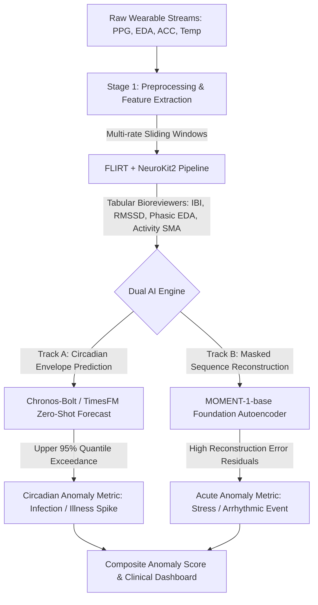

# Deep Technical Discovery: Pretrained Physiological & Time-Series Foundation Models, Feature Toolkits & Benchmark Datasets
## Research Track 3

---

## Executive Summary & Triage Matrix

For rapid decision-making in a **2-week implementation sprint**, models and libraries are categorized across three operational tiers:

```
+-----------------------------------------------------------------------------------------------+
| TIER 1: Out-of-the-Box Production Ready (pip install, stable weights, <10 min setup) |
| -> MOMENT (momentfm), Chronos-Bolt (chronos-forecasting), TimesFM (timesfm), PatchTST (hf) |
| -> Biomarker Toolkits: NeuroKit2 (neurokit2), FLIRT (flirt), HeartPy (heartpy) |
+-----------------------------------------------------------------------------------------------+
| TIER 2: Research Working Artifacts (Git clone, custom scripts, functional weights) |
| -> NormWear (mosaic-laboratory), UniTS (mims-harvard), Lag-Llama (gluonts), pyPPG (pyPPG) |
| -> SleepPPG-Net (DavyWJW repo) |
+-----------------------------------------------------------------------------------------------+
| TIER 3: Restricted / Academic Only (Weights private, HIPAA enclaves, non-reproducible) |
| -> HeartBEiT (weights withheld), Apple Heart & Movement Study (proprietary Apple/BWH enclave) |
+-----------------------------------------------------------------------------------------------+
```

---

## Part 1: Deep Dive into Foundation Models

### 1. NormWear (Mobile Sensing & UbiComp Lab / MOSAIC)

#### A. Core Architecture & Training Data
* **Architecture:** Dual-track Transformer Encoder-Decoder specifically customized for multivariate wearable biosignals.
 * *Track 1 (Cross-Patches):* 12 Transformer encoder layers operating along the temporal dimension over tokenized subseries patches.
 * *Track 2 (Cross-Channels):* 6 Transformer encoder layers capturing inter-sensor dynamics across modalities.
 * *Decoder:* 2 lightweight Transformer layers (latent dim 512, feedforward dim 3072, 12 attention heads, latent encoder dim 768).
* **Pretraining Objective:** Self-supervised masked signal reconstruction across heterogeneous physiological channels using a shared `[CLS]` token and channel-aware positional/modal embeddings.
* **Training Data:** Curated collection of open wearable/physiological datasets across PPG, ECG, EEG, GSR/EDA, and 3-axis IMU (~hundreds of gigabytes across diverse subjects).

#### B. Supported Tasks
* **Representation Extraction:** Self-supervised feature embeddings from multi-channel streams.
* **Zero-shot / Few-shot Classification:** Mental health detection (stress, anxiety), sleep stages, activity recognition.
* **Vital Sign Estimation & Anomaly Scoring:** Reconstruction loss deviation across physiological channels.
* **Forecasting (NormWear-2):** Latent world model for future physiological state rollout.

#### C. Usability Classification
* **Pretrained Open Weights:** Yes, hosted on Hugging Face (`mosaic-laboratory/normwear`, `mosaic-laboratory/normwear2`).
* **Zero-Shot Support:** Yes, for representation extraction and reconstruction anomaly detection.
* **Fine-Tuning Requirement:** Linear probing or partial-shot fine-tuning recommended for specialized classification downstream tasks.
* **Deployment Form:** Local PyTorch Python codebase.
* **Code Readiness:** **Tier 2 (Research Artifact).** Does not have a clean `pip install normwear` package; requires cloning repo, matching PyTorch/CUDA environment versions, and writing custom dataset loaders.

#### D. Hardware & Compute Requirements
* **Encoder Size:** ~85M–110M parameters.
* **Inference:** CPU-runnable for single-window representation extraction (~150ms on modern x86 CPU).
* **Batch Feature Extraction & Fine-Tuning:** 1x GPU with 8GB–16GB VRAM (RTX 3080/4090 or T4/V100).

#### E. URLs & Package Identifiers
* **GitHub:** `https://github.com/Mobile-Sensing-and-UbiComp-Laboratory/NormWear`
* **HuggingFace Hub:** `https://huggingface.co/mosaic-laboratory/normwear`
* **PyPI Package:** None (requires manual submodule integration).

#### F. Wearable Anomaly Detection Suitability
* **Missing Data:** Moderately resilient due to masked tokenization; zero-padding or channel masking allows graceful degradation when one sensor disconnects.
* **Multi-Rate Sampling:** Requires upstream resampling to a unified temporal patch rate (e.g., upsampling EDA 4Hz and downsampling PPG 64Hz to a canonical grid).
* **Circadian Cycles:** Encodes multi-scale diurnal shifts when sequence windows cover sufficient context length (typically 15-min to 1-hour patches).

#### G. Major Limitations & Failure Modes
* Brittle dependency tree; research repo lacks standardized PyTorch Lightning or HuggingFace `pipeline()` wrapper.
* Fixed patch sizes make it sensitive to severe frequency domain shifts if preprocessing resampling is done incorrectly.

#### H. Architectural Lesson for 2-Week Sprint
* The **dual-track architecture** (temporal cross-patch attention followed by spatial cross-channel attention) is the optimal theoretical design for fusing asynchronous wearable sensors (PPG + EDA + ACC).

---

### 2. MOMENT (CMU Auton Lab)

#### A. Core Architecture & Training Data
* **Architecture:** Masked Time-Series Modeling Transformer built on a modular T5-encoder backbone.
 * *Sizes:* `MOMENT-1-small` (38M), `MOMENT-1-base` (125M), `MOMENT-1-large` (385M).
 * *Components:* Subseries Patching (patch length $P=8$ or $16$), Reversible Instance Normalization (RevIN) to normalize non-stationary signals, and a lightweight, task-specific output head.
* **Pretraining Objective:** High-ratio masked autoencoding (e.g., masking 70% of patches and reconstructing original time series in the time domain using MSE loss).
* **Training Data:** **"The Time-series Pile"** — a multi-domain dataset spanning over 1 billion time points across healthcare (ECG, EEG, vitals), IoT, finance, energy, and weather.

#### B. Supported Tasks
* **Forecasting:** Short and long horizon ($H \in [96, 720]$ steps).
* **Zero-Shot Anomaly Detection:** Computing reconstruction error ($|x - \hat{x}|$) over masked/unmasked patches.
* **Classification & Imputation:** Linear probing or full fine-tuning; zero-shot interpolation of missing sequences.
* **Representation Extraction:** Extracting patch-level or pooled sequence embeddings.

#### C. Usability Classification
* **Pretrained Open Weights:** Yes, fully public on Hugging Face under Apache-2.0 license.
* **Zero-Shot Support:** Native zero-shot anomaly detection, imputation, and representation extraction.
* **Fine-Tuning Requirement:** Zero-shot works immediately for reconstruction/forecasting; classification requires a light linear head.
* **Deployment Form:** Local Python library.
* **Code Readiness:** **Tier 1 (Production Ready).** Direct pip install (`pip install momentfm`), well-documented, clean HuggingFace integration.

#### D. Hardware & Compute Requirements
* `MOMENT-1-small` (38M): Runs in <20ms on CPU; <500MB RAM.
* `MOMENT-1-base` (125M): 2GB–4GB VRAM GPU or modern multi-core CPU.
* `MOMENT-1-large` (385M): 8GB VRAM GPU.

#### E. URLs & Package Identifiers
* **GitHub:** `https://github.com/moment-timeseries-foundation-model/moment`
* **HuggingFace Hub:** `https://huggingface.co/AutonLab/MOMENT-1-base`
* **PyPI Package:** `momentfm`

#### F. Wearable Anomaly Detection Suitability
* **Missing Data:** Native reconstruction/imputation module handles bursty missing packets seamlessly.
* **Multi-Rate Sampling:** Employs **channel-independence**; multi-channel inputs are processed as independent channels through shared weights.
* **Circadian Cycles:** RevIN eliminates long-term baseline drift while retaining local cycle morphology.

#### G. Major Limitations & Failure Modes
* Channel independence means the core attention layers cannot learn joint cross-sensor covariances directly. Cross-sensor fusion must occur downstream.
* Context window is typically capped at 512 time steps per window.

#### H. Architectural Lesson for 2-Week Sprint
* **Immediate Top Candidate:** Use `momentfm` for zero-shot physiological anomaly detection. By feeding 512-step windows of normalized heart rate or skin temperature and computing the reconstruction loss vector, you obtain an out-of-the-box anomaly detector without writing training code.

---

### 3. TimesFM (Google Research)

#### A. Core Architecture & Training Data
* **Architecture:** Decoder-only autoregressive Transformer (TimesFM-1.0: 200M params; TimesFM-2.0: 500M params).
 * *Input Patching:* Uses residual input patches of length 32 tokens, mapped to Transformer embeddings.
 * *Causal Self-Attention:* Generates multi-step forecasts in single forward passes using learned causal patch attention.
* **Pretraining Objective:** Multi-horizon autoregressive next-patch prediction with quantile regression loss heads.
* **Training Data:** Pretrained on >100 billion real-world and synthetic time-series observations.

#### B. Supported Tasks
* **Zero-Shot Forecasting:** Univariate and multivariate point and probabilistic forecasting.
* **Covariate Support (XReg):** Dynamic categorical and continuous covariates (e.g., time-of-day, day-of-week, activity state).
* **Anomaly Detection via Prediction Interval Deviation:** Flagging points where actual telemetry exceeds 90th/95th forecasted confidence intervals.

#### C. Usability Classification
* **Pretrained Open Weights:** Yes, Apache-2.0 on Hugging Face Hub (`google/timesfm-1.0-200m`).
* **Zero-Shot Support:** Native zero-shot forecasting out-of-the-box.
* **Fine-Tuning Requirement:** Zero fine-tuning required for standard forecasting.
* **Deployment Form:** Local Python library with PyTorch and JAX backends.
* **Code Readiness:** **Tier 1 (Production Ready).** `pip install timesfm[torch]` or `pip install timesfm[flax]`.

#### D. Hardware & Compute Requirements
* **Memory:** Model size ~800MB.
* **Inference:** CPU runnable (100–300ms per forecast); GPU (2GB–4GB VRAM) achieves <15ms latency per batch.

#### E. URLs & Package Identifiers
* **GitHub:** `https://github.com/google-research/timesfm`
* **HuggingFace Hub:** `https://huggingface.co/google/timesfm-1.0-200m`
* **PyPI Package:** `timesfm`

#### F. Wearable Anomaly Detection Suitability
* **Circadian Cycles:** Superb capability to model 24-hour and weekly cyclic rhythms when supplied with past 7–14 days of hourly resting vitals.

#### G. Architectural Lesson for 2-Week Sprint
* Deploy TimesFM as a **Circadian Digital Twin**: Forecast the next 24-hour resting heart rate / temperature envelope. Any acute physiological deviation (e.g., infection/fever onset) that breaks the 95% quantile forecast threshold is flagged as an infection anomaly.

---

### 4. Chronos & Chronos-Bolt (Amazon Science)

#### A. Core Architecture & Training Data
* **Chronos-Bolt:** Subseries patching + direct multi-quantile regression decoder. 250x faster and 20x more memory-efficient than original Chronos.
* **Training Data:** Synthetic time series generated via Gaussian Processes and dynamic mixture models (TSMix), blended with 10M+ open time-series series.

#### B. Supported Tasks
* **Zero-Shot Univariate Probabilistic Forecasting:** Quantile predictions ($10\%, 20\%, \dots, 90\%$).
* **Forecasting-based Anomaly Detection:** Real-time statistical confidence bounds.

#### C. Usability Classification
* **Pretrained Open Weights:** Full public release on Hugging Face under Apache-2.0.
* **Zero-Shot Support:** Complete zero-shot capability.
* **Code Readiness:** **Tier 1 (Flawless Production Experience).** `pip install chronos-forecasting`.

#### D. Hardware & Compute Requirements
* `chronos-bolt-tiny` (9M) / `mini` (21M): <15ms on standard CPU.
* `chronos-bolt-base` (200M): ~1.5GB VRAM GPU or fast CPU.

#### E. URLs & Package Identifiers
* **GitHub:** `https://github.com/amazon-science/chronos-forecasting`
* **HuggingFace Hub:** `https://huggingface.co/amazon/chronos-bolt-base`, `amazon/chronos-bolt-tiny`
* **PyPI Package:** `chronos-forecasting`

---

## Part 2: Comparative Analysis of Specialized Models

| Feature | HeartBEiT | SleepPPG-Net | UniTS | PatchTST | Lag-Llama |
| :--- | :--- | :--- | :--- | :--- | :--- |
| **Core Architecture** | Vision Transformer (ViT-B) on 12-lead ECG | 1D-ResNet (local) + TCN (inter-epoch context) | Unified Sequence/Variable Transformer + Task Tokens | Channel-Independent Patch Transformer + RevIN | LLaMA-based Decoder-only Transformer + RoPE |
| **Pretrained Weights** | **Withheld** (Proprietary clinical Mayo/Stanford data) | Available in GitHub research repos | Open on GitHub / Zenodo | HF Transformers Hub (`ibm/patchtst`) | Open on HuggingFace Hub |
| **Primary Task** | Diagnostic 12-lead ECG classification | 4-class sleep staging from continuous PPG | Unified: Forecasting, Clf, Imputation, Anomaly | Long-term Forecasting & Representation | Univariate Probabilistic Forecasting |
| **Code Usability** | **Tier 3 (Brittle / Research)** | **Tier 2 (Git clone repo)** | **Tier 2 (Git clone repo)** | **Tier 1 (pip install transformers)** | **Tier 2 (Git clone + GluonTS)** |
| **Pip Package** | None | None | None | `transformers`, `neuralforecast` | None (`pip install -r requirements.txt`) |
| **Hardware Reqs** | High (GPU 16GB+ VRAM) | Low (CPU or 2GB GPU) | Medium (GPU 8GB VRAM) | Ultra-light (CPU or 2GB GPU) | Light (~2.4M params, CPU/GPU) |
| **Wearable Suitability** | Poor (clinical ECG only) | **High** (raw wearable PPG waveforms) | High (multivariate multi-task) | High (long-context multi-day vitals) | Moderate (strict lag dependency) |

---

## Part 3: Physiological Feature Engineering & Biomarker Toolkits

1. **NeuroKit2 (`neurokit2`):** Standard Python library for biosignal processing. Extracts time/frequency/nonlinear HRV (SDNN, RMSSD, HF, LF, SampEn), PPG pulse morphological parameters, and EDA phasic/tonic components.
2. **FLIRT (`flirt`):** Feature generation specifically designed for consumer wearables (Apple Watch, Empatica). Resolves multi-rate sampling alignment and calculates >100 tabular features across sliding windows.
3. **HeartPy (`heartpy`):** Algorithmic toolkit designed explicitly for noisy, artifact-laden PPG signals in naturalistic environments.

---

## Part 4: Open Benchmark Datasets

1. **Stanford COVID-19 Wearables (Mishra et al. / Alavi et al.):** Longitudinal 1-minute HR, step counts, and sleep logs from >5,000 participants with confirmed PCR infection timestamps. Gold standard for infection detection lead time benchmarking.
2. **WESAD (Wearable Stress and Affect Detection - UCI):** 15 subjects with continuous PPG, EDA, EMG, Respiration, Temp, and Accelerometry with gold-standard stress/baseline/amusement labels.
3. **PhysioNet Apple Watch Sleep Studies:** Continuous Apple Watch 50Hz accelerometry and 5s heart rate paired with Polysomnography (PSG) and Dreem EEG ground-truth.

---

## Part 5: Recommended 2-Week Implementation Blueprint


